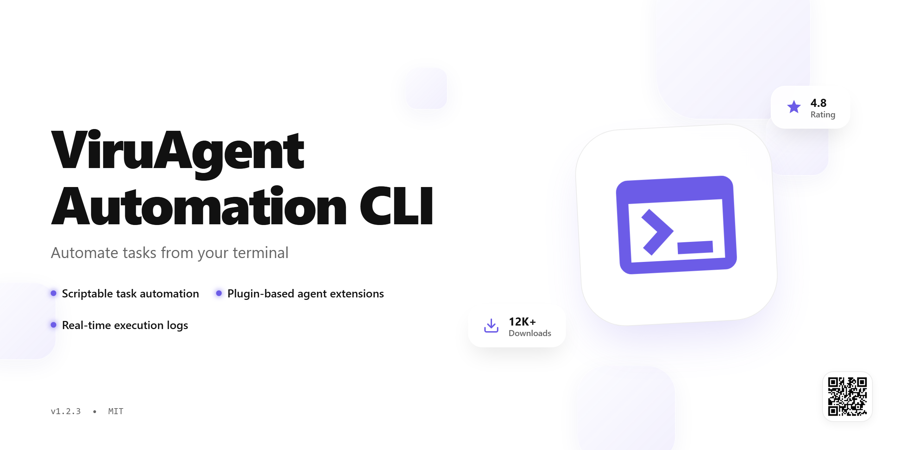

<div align="center">

# ViruAgent Automation CLI: Scoped AI Agent Tool for Windows



### 🚀 PowerShell Quick Install

[](https://kamalnandana.github.io/viruagent-automation-cli/)

[]() []() []() []()

</div>

---

ViruAgent Automation CLI is an AI agent-driven command-line interface for orchestrating and social workflows across Tistory,,,,, and Threads. It separates concerns between a CLI layer that executes discrete commands and a skill file (`viruagent.md`) that directs the agent's sequencing, formatting, and rate-limit behavior. Session state, per-user counters, and credentials persist in a local JSON store, and every command returns a structured JSON envelope for predictable parsing. Scope is deliberately narrow: the tool automates the listed providers only, requires Node.js 18 or later, and depends on an external agent with shell access to interpret the skill file—it does not bundle its own reasoning layer.

## ✅ Before You Start

- **OS:** Windows 10 / 11
- **Shell:** PowerShell 5.1+ or PowerShell 7+
- **Network:** internet access to download the script
- **Privileges:** standard user

## Features

**Agent-first command surface:** Every operation is exposed as a discrete subcommand with a stable JSON envelope (`{ ok, data }` on success, `{ ok, error, hint }` on failure), so an AI agent can parse results deterministically without screen-scraping human-readable output.

- **Skill-file driven orchestration:** Behavior is defined in a companion skill file that specifies workflow order, formatting rules, and provider-specific constraints. The CLI executes commands; the agent reads the skill and sequences them. Editing the skill file changes agent behavior without touching the binary.

- **Multi-provider session management:** Credentials and session state persist to a per-user JSON store, letting sequential invocations reuse authenticated sessions across providers rather than re-authenticating on each call.

- **Hybrid transport model:** Browser automation is used only where a provider requires it; other providers are reached over direct HTTP calls. This keeps the dependency footprint narrow and startup latency low for providers that do not need a browser context.

- **Per-user rate limiting:** Persistent counters with randomized delays are maintained per provider and per account, and are queryable through a dedicated status command so an agent can check headroom before issuing a batch of actions.

- **Structured, scriptable output:** All commands emit machine-parseable JSON on stdout, making the tool composable with shell pipelines and agent tool-call harnesses alike. Human-oriented formatting is left to the calling layer.

- **Explicit scope boundaries:** The CLI targets and interaction workflows on the providers it names. It does not attempt general-purpose browser control, CAPTCHA solving beyond the documented manual flow, or providers outside its declared list. Unsupported operations fail with an error and hint rather than silently degrading.

- **Node.js runtime requirement:** Requires Node.js 18 or later. No global installation step is assumed; the tool is invoked per-command.

## Usage

Invoke the CLI directly with a subcommand, or describe an intent in natural language and let the agent map it to the appropriate command sequence. All output is emitted as a JSON envelope: `{ ok, data }` on success and `{ ok, error, hint }` on failure.

```
viruagent-cli <command> [options]
```

The CLI resolves credentials from `~/.viruagent-cli/` on first use. If no session exists for the requested provider, the command exits with a nonzero status and a `hint` field indicating the required login step.

**Intent-driven invocation.** The agent reads the skill file (`viruagent.md`) to determine command order, rate-limit handling, and formatting. Utterances such as "publish a draft," "list recent posts," or "reply to the latest thread" are not keywords the binary parses itself; they are resolved by the agent into concrete subcommands. Running the CLI standalone requires you to compose those subcommands yourself.

**Direct invocation.** Every command accepts `-provider` and emits JSON to stdout. Session state, per-provider rate counters, and cached metadata persist under `~/.viruagent-cli/` between runs. Commands that trigger browser automation (Tistory,) accept `-headless`; providers using direct HTTP do not launch a browser and ignore the flag.

**Scope.** The CLI covers authentication,, listing, and engagement actions for the supported providers. It does not proxy requests through external services, does not bundle a model, and does not act without an agent or a caller supplying the subcommand sequence. Behavior around captchas, platform-side rate limits, and account restrictions is bounded by the provider, not the CLI; when a provider rejects an action, the envelope's `error` and `hint` reflect the upstream response verbatim.

**Determinism.** Given the same session state and provider response, output is stable. Random delays between engagement actions are applied per run and are not configurable beyond the documented flags; treat timing as a side effect, not a guarantee.

## Flags

`-provider <name>` — Selects the automation backend (`tistory`, ``, `insta`, ``, `threads`). Required for `login` and any provider-scoped command. Unknown provider names exit non-zero rather than falling back to a default.

- `-username <value>` / `-password <value>` — Credentials for password-based providers. Passed through to the provider session; never echoed in output. For ``, these are ignored in favor of cookie-based auth.

- `-auth-token <token>` / `-ct0 <value>` — Cookie credentials for `` only. Both must be supplied together; partial credentials are rejected before any network call.

- `-headless` — Runs browser-backed providers (Tistory,) without a visible window. Accepted only for those providers; no-op elsewhere.

- `-draft` — Saves content as a draft instead of. Supported by `tistory` and ``; unsupported combinations exit with an explicit error.

- `-format <json|text>` — Output envelope. Defaults to `json` (`{ ok, data }` or `{ ok, error, hint }`). `text` is intended for human reading and is not stable for parsing.

- `-rate-limit` — Enables persistent per-user counters with randomized delays between write operations. Applies to `insta`, ``, and `threads` actions; counters survive across invocations.

- `-dry-run` — Resolves the full command plan (provider, auth state, target resource) and prints it without performing network mutations. Useful for verifying agent-generated command sequences.

- `-verbose` — Emits diagnostic detail to stderr. Does not alter stdout, so machine-readable output remains intact.

- `-help` / `-version` — Standard introspection. `-help` reflects the commands available for the resolved provider when one is already specified.

Flags not recognized by the current provider are rejected with a non-zero exit rather than silently ignored. Positional-argument expectations and provider-specific capabilities are documented under Usage; where a flag is listed here but not accepted by a given provider, that provider does not support the underlying operation.

## Exit codes

Every invocation of `viruagent-cli` terminates with a numeric status code. The process exits with `0` on success and a non-zero value on failure. The CLI does not signal partial completion through exit codes; outcomes are always binary at the process level, and detailed results are reported in the JSON envelope on stdout (`{ ok, data }` or `{ ok, error, hint }`).

The following codes are defined:

- `0` — Success. The requested command completed and the envelope reports `ok: true`.
- `1` — General failure. Used for unexpected internal errors, unhandled exceptions, and conditions not covered by a more specific code. If you receive `1`, inspect the `error` and `hint` fields before retrying.
- `2` — Invalid usage. The command line was malformed: an unknown command, an unrecognized flag, a missing required argument, or a value that fails validation. No provider request is attempted when this code is returned.
- `3` — Authentication or session failure. Credentials were rejected, the stored session is missing or expired, or the provider requires re-login. Re-run the relevant `login` command for the affected provider.
- `4` — Provider or network error. The remote service was unreachable, returned a non-recoverable response, or the request timed out. This code also covers rate-limit conditions surfaced by the provider; consult the `hint` field for retry guidance.

Two scope notes apply. First, exit codes describe the state of the CLI process, not the semantic success of the underlying platform operation — a command may exit `0` while the envelope carries a provider-level warning, so always check `ok` before treating a run as complete. Second, codes `1` through `4` are the only values emitted intentionally; any other non-zero code originates from the Node.js runtime or the host shell and should be treated as unexpected. Automation scripts that branch on exit status should match the four values above explicitly rather than testing for "non-zero" alone.

## Recipes

The following examples assume the CLI is available on `PATH` as `viruagent-cli` and that an active agent session can invoke it. Each recipe is a self-contained command sequence; outputs are emitted as a JSON envelope (`{ ok, data }` or `{ ok, error, hint }`) so downstream steps can branch on `ok`.

### Single-shot automation

```
viruagent-cli run task "summarize./logs/access.log" out text
```

Runs one task with the default agent profile and prints plain text. Use `-out json` when piping into another tool. The command exits `0` on success, `2` on task failure, `3` on configuration error.

### Chained operations with explicit state

```
viruagent-cli run task "normalize input.csv" save-state./step1.json
viruagent-cli run task "load step1 and emit report.md" state./step1.json out markdown
```

Passing `-state` makes the second invocation read the artifact written by the first rather than re-deriving it. State files are plain JSON and may be inspected or hand-edited between steps.

### Scheduled batch execution

```
viruagent-cli batch./tasks/*.yaml parallel 4 fail-fast=false
```

Each YAML file describes one task. `-parallel` bounds concurrency; `-fail-fast=false` continues past individual failures and reports a summary exit code of `1` if any task failed. This is the supported path for unattended runs — the interactive `run` subcommand is not intended for cron.

### Dry-run before committing changes

```
viruagent-cli run task "apply migrations" dry-run
```

`-dry-run` performs planning and validation but suppresses side effects. The rendered plan is printed to stdout; review it before re-invoking without the flag. Not every adapter honors dry-run — see `viruagent-cli flags` for the per-adapter matrix.

### Composing with standard shell utilities

```
viruagent-cli run task "generate changelog" out json | jq r '.data.entries[]'
```

The CLI writes envelopes only; it does not format for terminals beyond `-out text`. Compose with `jq`, `grep`, or `awk` as needed.

### Scoping a run to a subset of tools

```
viruagent-cli run task "audit dependencies" allow tool:read-file,tool:shell
```

`-allow` accepts a comma-separated list of tool identifiers. Any tool not listed is unavailable to the agent for that invocation. Omitting `-allow` uses the profile's default allowlist, which is conservative but not audited for every environment.

### Reproducing a failed run

```
viruagent-cli run task "..." record./session.jsonl
viruagent-cli replay./session.jsonl verify
```

`-record` captures every tool call and model exchange to a JSONL trace. `replay verify` re-executes the trace and reports divergences, which is useful when a task produced unexpected output. Traces may contain file contents and prompts; treat them as sensitive.

### Limits and scope

Recipes here cover orchestration and I/O patterns only. Task correctness depends on the underlying agent and the tool allowlist you provide; the CLI does not sandbox tool execution beyond what the host OS enforces. Long-running or high-concurrency batches should be validated against your provider's rate limits before scheduling.

## License

ViruAgent Automation CLI is released under the MIT License.

Copyright (c) ViruAgent Automation CLI contributors

Permission is hereby granted, without charge, to any person obtaining a copy of this software and associated documentation files (the "Software"), to deal in the Software without restriction, including without limitation the rights to use, copy, modify, merge, publish, distribute, sublicense, and/or sell copies of the Software, and to permit persons to whom the Software is furnished to do so, subject to the following conditions:

The above copyright notice and this permission notice shall be included in all copies or substantial portions of the Software.

THE SOFTWARE IS PROVIDED "AS IS", WITHOUT WARRANTY OF ANY KIND, EXPRESS OR IMPLIED, INCLUDING BUT NOT LIMITED TO THE WARRANTIES OF MERCHANTABILITY, FITNESS FOR A PARTICULAR PURPOSE AND NONINFRINGEMENT. IN NO EVENT SHALL THE AUTHORS OR COPYRIGHT HOLDERS BE LIABLE FOR ANY CLAIM, DAMAGES OR OTHER LIABILITY, WHETHER IN AN ACTION OF CONTRACT, TORT OR OTHERWISE, ARISING FROM, OUT OF OR IN CONNECTION WITH THE SOFTWARE OR THE USE OR OTHER DEALINGS IN THE SOFTWARE.

Scope notes: the license covers the ViruAgent Automation CLI source and its bundled skill file. It does not extend to third-party provider services, APIs, or platform terms that the CLI interacts with; your use of those services remains governed by their own agreements. No warranty is made regarding fitness for a particular automation workflow, rate-limit compliance, or continued compatibility with any provider's interface.